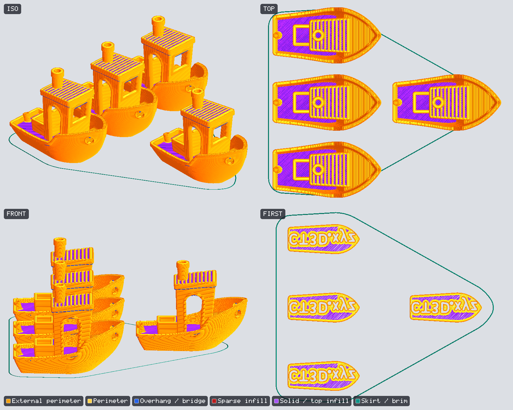
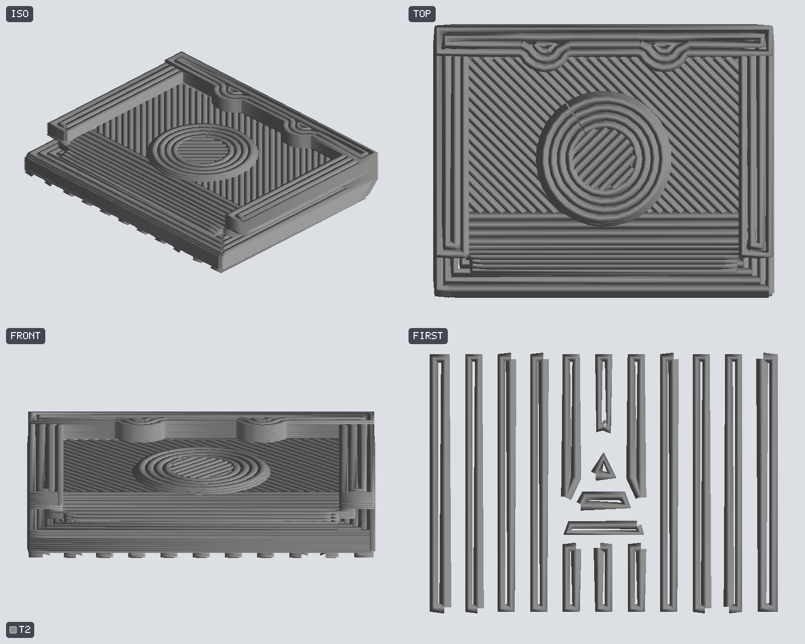
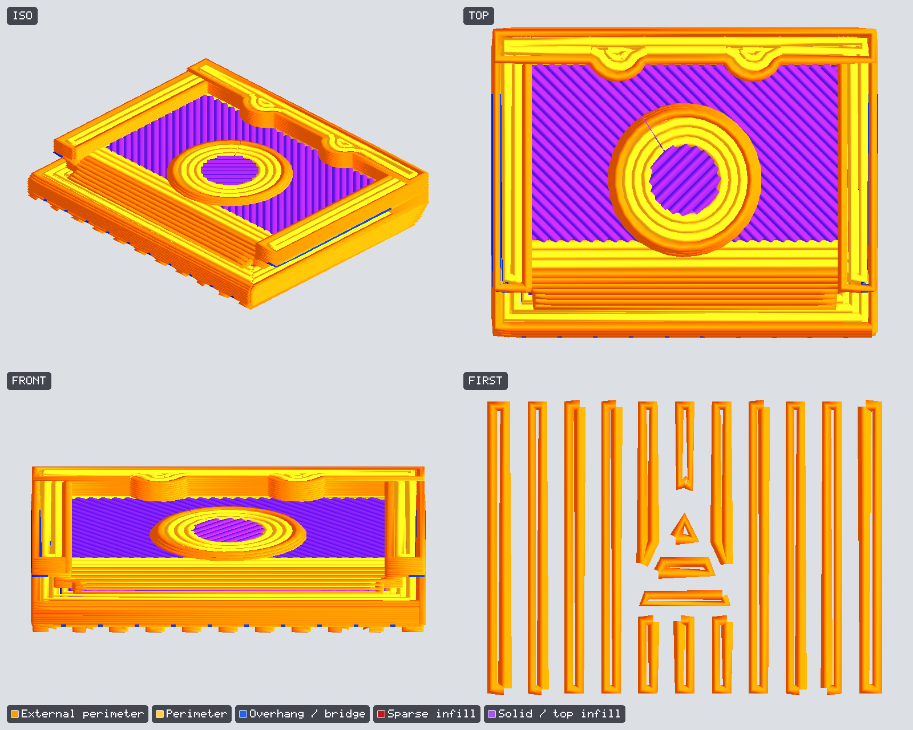
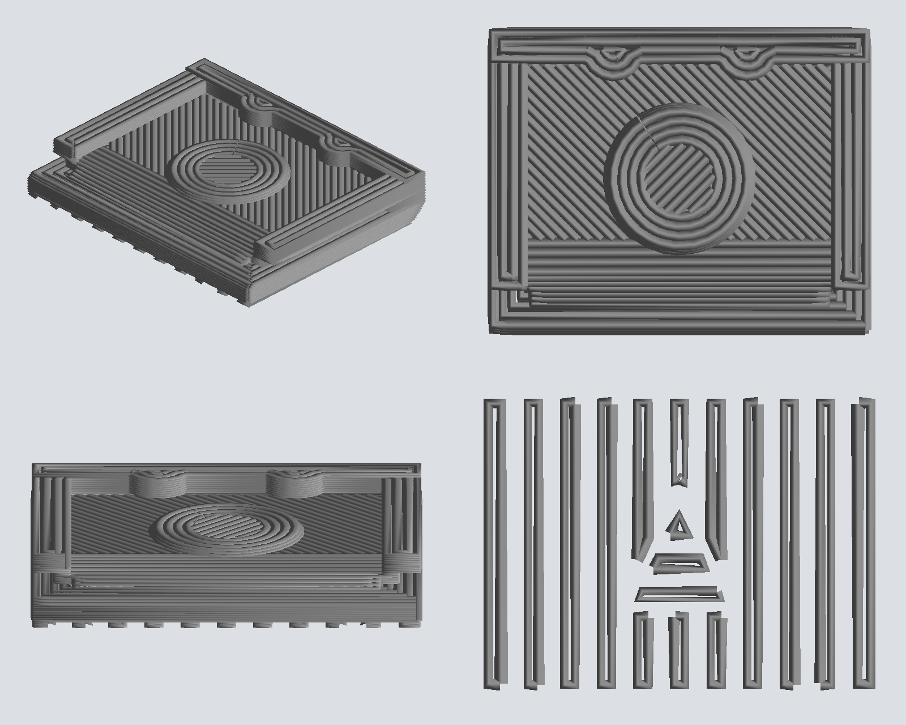
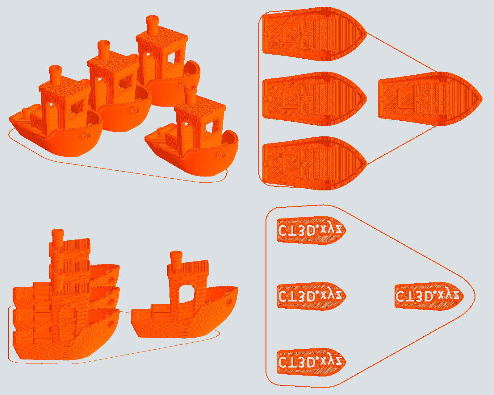
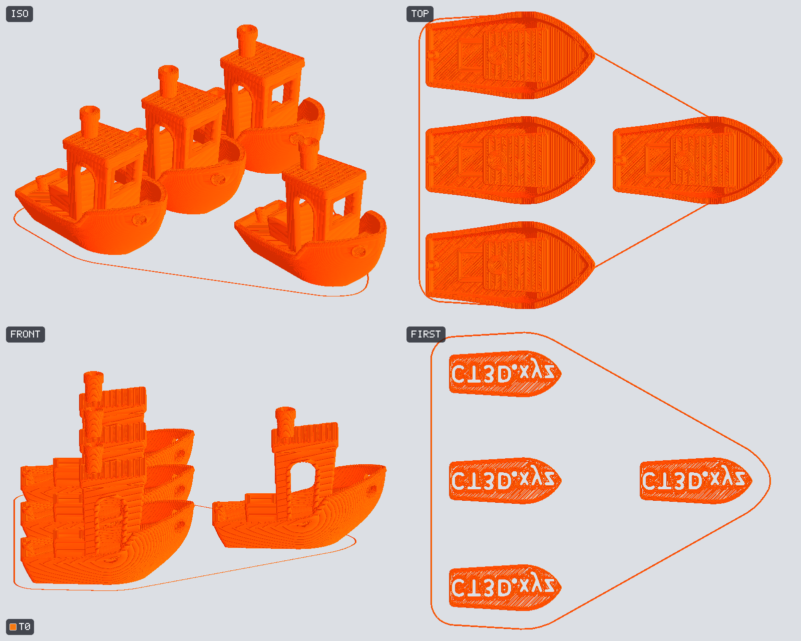

# gcode-sheet

Headless 3D-print G-code / `.bgcode` toolpath contact-sheet renderer, packaged as a Nix flake for `x86_64-linux` and `aarch64-linux`.

`gcode-sheet` renders sliced 3D-print toolpaths (such as Prusa MK4 + MMU3 output) into a multi-view PNG contact sheet (`iso`, `top`, `front`, `first`, `right`, `bottom`) of shaded 3D extrusion tubes coloured either by MMU tool/slot or by PrusaSlicer feature type (`;TYPE:` blocks). It runs entirely in Node.js without a browser or display server using Three.js, `webgl-node` (`native-gles`), and Mesa `llvmpipe` in surfaceless EGL mode, with `libbgcode` wired in to accept `.bgcode` files directly.



## Quick Start (`nix run`)

Run directly from GitHub on any `.bgcode` or `.gcode` file:

```bash
nix run github:werdnum/gcode-sheet -- part.bgcode out.png
```

Or from a local checkout:

```bash
nix run . -- caliper-battery-cover-flatbase-0.1mm-black-pla-slot3.bgcode out.png
nix run . -- caliper-battery-cover-flatbase-0.1mm-black-pla-slot3.bgcode out-feature.png --color-by feature
```

 Run the flake test suite (renders the bundled caliper `.bgcode` fixture and verifies the PNG dimensions, pixel count, and JSON summary):

```bash
nix flake check -L
```

## Example Output

### Caliper Battery Cover (`.bgcode` fixture)

| Colour by Tool (`--color-by tool`) | Colour by Feature (`--color-by feature`) |
|---|---|
|  |  |

### Stdout JSON Summary

Every run prints a JSON summary to `stdout` for downstream automation / AI inspection:

```json
{
  "output": "out.png",
  "views": ["iso", "top", "front", "first"],
  "layers": 29,
  "tools": [2],
  "detail": "full",
  "colorBy": "tool",
  "legend": ["T2=#8C8C8C"],
  "bbox_mm": {
    "x": [116.55, 133.46],
    "y": [98.27, 111.73],
    "z": [0.2, 3]
  }
}
```

## CLI Options

```
Usage: gcode-sheet INPUT.(gcode|bgcode) OUTPUT.png [options]
```

| Option | Default | Description |
|---|---|---|
| `--views LIST` | `iso,top,front,first` | Comma-separated panels (`iso`, `top`, `front`, `right`, `bottom`, `first`), arranged in a 2-column grid |
| `--color-by MODE` | `tool` | `tool` (colour by MMU tool `T0..T7` / `M600` changes) or `feature` (colour by `;TYPE:` blocks) |
| `--tool-colors HEX,...` | `#F67910,#F2F2F2,#8C8C8C,#7B2FBE,#9A9A9A` | Comma-separated hex colours for `T0..T7` (default matches Prusa MMU3 slots 1–5, with black lifted to grey for shading contrast) |
| `--size N` | `800` | Panel width in pixels (each panel is `N` × `0.8*N`, so default 4-panel sheet is `1600×1280`) |
| `--detail MODE` | `auto` | `full`, `shell` (hides interior perimeters/infill/gap-fill above layer 1), or `auto` (`shell` when decoded G-code > 9 MB) |
| `--end-layer N` | *(all)* | Cut the 3D views at layer `N` (1-based) |
| `--include-start` | `false` | Include extrusions before the first `;LAYER_CHANGE` (hides the start-gcode purge line by default) |
| `--include-wipe-tower` | `false` | Include `;TYPE:Wipe tower` in the camera bounding-box fit (excluded by default so the printed part fills the frame) |
| `--light A,D,B` | `0.6,1.2,1.5` | Ambient, directional, and brightness multipliers for the tube shader |
| `--background HEX` | `#DCDFE4` | Background colour |
| `--extrusion-width MM` | `0.45` | Fallback extrusion width in mm before the first `;WIDTH:` comment |
| `--layer-height MM` | `0.2` | Fallback layer height in mm before the first `;HEIGHT:` comment |
| `--arc-tol MM` | `0.05` | Chord tolerance in mm when tessellating `G2`/`G3` arcs |
| `--lines` | `false` | Render flat `GL_LINES` segments instead of shaded 3D tubes |
| `--no-labels` | `false` | Omit the built-in panel view badges and bottom-left colour legend overlay |
| `-h`, `--help` | | Print CLI usage help |

### Feature Colour Groups (`--color-by feature`)

| Feature Group | PrusaSlicer `;TYPE:` | Colour |
|---|---|---|
| External perimeter | `External perimeter` | `#F59E0B` (amber) |
| Perimeter | `Perimeter` | `#FCD34D` (yellow) |
| Overhang / bridge | `Overhang perimeter`, `Bridge infill` | `#2563EB` (blue) |
| Sparse infill | `Internal infill` | `#B91C1C` (red) |
| Solid / top infill | `Solid infill`, `Top solid infill`, `Gap fill`, `Ironing` | `#A855F7` (purple) |
| Support | `Support material`, `Support material interface` | `#16A34A` (green) |
| Skirt / brim | `Skirt/Brim`, `Skirt`, `Brim` | `#0D9488` (teal) |
| Wipe tower / other | `Wipe tower`, `Custom`, any other `;TYPE:` | `#6B7280` (grey) |

## Benchmarks

The `bench/` directory contains scripts to reproducibly generate medium (~11.2 MB) and large (~22.4 MB) G-code and `.bgcode` plates by slicing the bundled PrusaSlicer `3DBenchy.stl` with a Prusa MK4 0.4 mm nozzle / 0.2 mm layer / 15% gyroid infill profile (`bench/mk4.ini`), and to measure wall time and peak RSS.

### Running the Benchmarks

```bash
# Generate benchmark G-code / bgcode files in bench/data/ (uses nix shell for prusa-slicer + libbgcode)
./bench/generate.sh

# Run the benchmark suite and print the Markdown table
./bench/run.sh
```

### Before vs. After Performance (`x86_64-linux`, Mesa `llvmpipe`)

| Benchmark | Size | Detail | Before (Draft) Time | After Time | Speedup | Before Peak RSS | After Peak RSS | Memory Reduction |
|---|---:|---|---:|---:|---:|---:|---:|---:|
| `caliper` (`.bgcode`) | 0.12 MB | `full` | *(n/a)* | **0.86 s** | — | *(n/a)* | **250 MB** | — |
| `caliper` (`.gcode`) | 0.29 MB | `full` | 1.06 s | **0.82 s** | **1.3×** | 322 MB | **251 MB** | **−22%** |
| `caliper` (`.gcode`) | 0.29 MB | `shell` | 0.93 s | **0.74 s** | **1.3×** | 288 MB | **240 MB** | **−17%** |
| `medium` (`.bgcode`) | 4.29 MB | `full` | *(n/a)* | **3.04 s** | — | *(n/a)* | **368 MB** | — |
| `medium` (`.gcode`, 4× Benchy) | 11.22 MB | `full` | 14.10 s | **2.48 s** | **5.7×** | 1,374 MB | **371 MB** | **−73% (3.7× less)** |
| `medium` (`.gcode`, 4× Benchy) | 11.22 MB | `shell` | 4.43 s | **1.44 s** | **3.1×** | 755 MB | **328 MB** | **−57% (2.3× less)** |
| `large` (`.gcode`, 8× Benchy) | 22.45 MB | `full` | 27.54 s | **3.51 s** | **7.8×** | 2,250 MB | **413 MB** | **−82% (5.4× less)** |
| `large` (`.gcode`, 8× Benchy) | 22.45 MB | `shell` | 7.62 s | **2.01 s** | **3.8×** | 973 MB | **353 MB** | **−64% (2.8× less)** |

### Summary of Optimisations

1. **Bypassed `gcode-preview`'s `BatchedMesh` 3× over-allocation and compact 4-segment diamond tubes**:
   - `gcode-preview` passed `position.count * 3` (number of floats instead of vertices) to `new THREE.BatchedMesh(maxInstanceCount, maxVertexCount, maxIndexCount)`, allocating **3× too much VBO memory** in both V8 and Mesa `llvmpipe`, plus `Uint32` indices, unused `uv` attributes, and duplicate seam vertices (`(L+1)*5` instead of `L*4`).
   - Building 4-segment diamond tube rings directly into reusable 16,380-point (`≤ 65,520` vertex) chunks with `Float32Array` positions, normalized `Int8Array` normals (`gl.BYTE`), and `Uint16Array` indices reduced per-point geometry memory from **~288 bytes/point to 68 bytes/point (4.2× smaller)**.
2. **Immediate GL upload + JS typed-array detachment**:
   - Each completed chunk is uploaded to its GL VBO immediately via a 1-triangle dummy draw (`setDrawRange(0, 3)`) and its JS typed arrays are replaced with empty 0-length views so the same single scratch buffer is reused across the entire file.
3. **Streaming 256 KB chunk reader + zero-allocation G-code parser**:
   - Eliminated `fs.readFileSync()`, full-file strings, `.split('\n')`, and `gcode-preview`'s millions of `GCodeCommand` and `Path` objects (which previously consumed ~760 MB of V8 heap on the 22.4 MB file before building any geometry).
   - For `.bgcode` files, the temporary decoded `.gcode` file is unlinked as soon as streaming completes, before final scene rendering.
4. **Online $O(1)$-memory exact camera frustum tracker**:
   - Instead of storing a duplicate `Float32Array` of all 4M+ vertices for camera fitting, we precompute the 2D camera-space projection basis vectors `(ux, uy)` for each view direction and track the 4 extreme 3D points per view online during parsing (`48 bytes` per view instead of `48 MB`).
5. **Fast planar horizontal tube path & per-chunk Z culling**:
   - Added a fast 2D perpendicular path for planar `Z`-constant moves (>99% of 3D print moves), avoiding 3 cross products and 2 `Math.sqrt` calls per point, and added per-chunk `minZ` visibility culling for `first` / `--end-layer` views.

### Before vs. After Visual Comparison

| Caliper (Before) | Caliper (After) |
|---|---|
|  |  |

| Medium 4× Benchy (Before) | Medium 4× Benchy (After) |
|---|---|
|  |  |
